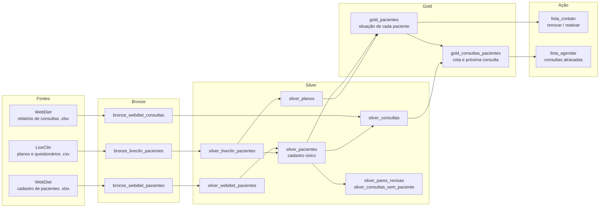

# Nutri Datas -> Estruturamento e melhora de dados.

Pipeline de dados em **Databricks** (arquitetura medalhão bronze → silver → gold) que construí para o meu consultório de nutrição. O pipeline une os dois sistemas que uso no dia a dia, limpa e deduplica os cadastros, e responde perguntas de negócio:

- **Quem eu preciso contatar agora** para renovar o plano antes que ele acabe, ou para reativar quem saiu há pouco?
- **Quem está com consulta atrasada** dentro do plano contratado?
- **Como a procura varia ao longo do ano** (sazonalidade) e quantos pacientes entram e saem?
- **Engajamento**: quem responde aos questionários de acompanhamento tende a continuar?

> **Privacidade (LGPD):** este repositório contém só código e **dados fictícios** gerados por script. Nenhum dado real de paciente foi publicado.

## Arquitetura



## O que cada camada faz

**Bronze**: os arquivos entram como vieram. Só os nomes das colunas são padronizados (`snake_case`, sem acento), e cada tabela ganha colunas de linhagem: `_arquivo_origem`, `_data_referencia` e `_carregado_em`.

**Silver**: limpeza, deduplicação e unificação.
- **Telefones** normalizados (com ou sem DDD, com +55, sem o nono dígito), com uma coluna de qualidade para cada um.
- **CPF** validado pelos dígitos verificadores. E-mail, gênero e datas padronizados.
- **Cadastros repetidos** no WebDiet unidos por chave determinística (nome normalizado + nascimento).
- **Correção de regra de negócio**: o plano Start passou de 45 para 30 dias, mas o sistema continuou gravando 45 em alguns casos. O pipeline recalcula a data de fim e guarda os valores originais para auditoria.
- **Pareamento entre sistemas** (*entity resolution*): os pares candidatos são gerados por telefone, e-mail ou nome. Cada par recebe uma nota de confiança pela soma de sinais (telefone, e-mail, nascimento e similaridade de nome com `difflib`). Os melhores pares são escolhidos 1 para 1. Casos ambíguos (por exemplo, familiares que dividem o mesmo telefone) vão para `silver_pares_revisao`, para revisão manual.
- **ID anônimo** (`P0001`…) numerado pela ordem de cadastro, que não revela nada sobre a pessoa.
- **Consultas** ligadas ao paciente. Duplicadas no mesmo dia são removidas, e consultas sem paciente identificado ficam em uma tabela à parte com o motivo.

**Gold**
- `gold_pacientes`: idade, faixa etária, mês de cadastro e uma **situação** para cada paciente (ativo, renovação próxima, encerrado recente, em risco, inativo…). Os limites de dias ficam em um único bloco `params`, fácil de ajustar.
- `gold_consultas_pacientes`: consultas usadas × cota do plano, intervalo mediano entre consultas, **próxima consulta prevista** e se ela está em dia ou atrasada.

**Ação**: views prontas para o dia a dia, com prioridade (P1 a P5), motivo do contato e link direto para o WhatsApp.

## Estrutura

```
notebooks/
  00_setup.sql                       schema e volume
  01_bronze.py                       ingestão das exportações
  02_silver.py                       limpeza, deduplicação, pareamento e gold_pacientes
  03_consultas.py                    consultas (bronze + silver), gold_consultas e lista de agendamento
  04_lista_contato_e_analises.py     lista de contato, sazonalidade, retenção e engajamento
scripts/
  gerar_dados_exemplo.py             gera os dados fictícios
dados_exemplo/                       dados fictícios no mesmo formato das exportações reais
```

## Como rodar

1. Importe a pasta `notebooks/` no seu Databricks (*Workspace → Import*). Funciona no Databricks Free Edition.
2. Rode o `00_setup.sql`.
3. Suba os três arquivos de `dados_exemplo/` no volume `workspace.nutri.raw` (*Catalog → nutri → raw → Upload*).
4. Rode os notebooks `01` a `04`, nessa ordem.

Para gerar outro conjunto fictício: `python scripts/gerar_dados_exemplo.py`.

## Tecnologias

Databricks (Unity Catalog, Volumes, Delta tables) · PySpark · pandas · SQL (CTEs, window functions, `percentile_approx`) · Python (`difflib`, `hashlib`, `unicodedata`)

## Próximos passos

- Orquestrar os notebooks em um **Job** com agendamento semanal.
- Ingestão incremental (hoje cada carga sobrescreve a tabela).
- Ligar as consultas ao paciente por um identificador, e não só pelo nome.
- Dashboard no Databricks SQL com a lista de contato e os indicadores de retenção.

## Autor

**João Gabriel** — nutricionista e analista de dados.
